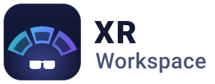

<p align="center"></p>

# VITURE Workspace

VITURE Workspace turns your VITURE glasses into a big multi-screen desk on Omarchy. Put the glasses on and you see
three extra desktops floating in front of you. They stay where you put them when you turn your head, and you can use
them with your normal keyboard and mouse.

It works with the VITURE **Luma Ultra** (tested in the glasses) and **Beast** (only partly tested so far).

## What you need

- A computer running [Omarchy](https://omarchy.org) (it uses the Hyprland window manager).
- VITURE Luma Ultra or Beast glasses, plugged in.
- XRLinuxDriver (`xr-driver-git`). It reads the glasses' motion sensors so the desktops can react to your head.
- To build it: CMake, a C++ compiler, and Python 3.10 or newer.
- Optional, for videos: `mpv` (playing), `ffmpeg` (web videos), `zenity` (the file picker), `wl-clipboard` and Chromium
  (the browser button).

## Getting started

### 1. Install

Run these from this folder:

```sh
# Build the program that draws in the glasses
cmake -S spike -B build/release -DCMAKE_BUILD_TYPE=Release \
  -DXR_ENABLE_HARDWARE=OFF -DXR_ENABLE_SDK=OFF -DXR_ENABLE_OWNERSHIP_PLUGIN=ON
cmake --build build/release -j

# Install it and the background helper, then start the helper
python -m tools.xr_controller install --build build/release
systemctl --user start viture-workspace-controller.service

# Add the panel to Omarchy
ln -s "$PWD/omarchy-plugin/cody.viture-workspace" ~/.config/omarchy/plugins/
omarchy-shell shell rescanPlugins

# Optional: app icon and a launcher entry
install -Dm644 assets/icon.svg ~/.local/share/icons/hicolor/scalable/apps/viture-workspace.svg
install -Dm644 packaging/viture-workspace.desktop ~/.local/share/applications/
gtk-update-icon-cache -f -t ~/.local/share/icons/hicolor
```

The background helper never starts anything in the glasses by itself. It waits for you to press Start.

### 2. Open the panel

Plug in the glasses, then open **VITURE Workspace** from the app launcher. You can also add the small **XR** widget to
your bar and click it.

If the panel says "controller not running", click **Start / restart controller**.

### 3. Start a session

1. Optional: click a desktop to change its size, sharpness or where it sits.
2. Press **Start XR session**.
3. A box shows what the session will do, such as switching the glasses to 120 Hz for this session. Press **Start**.
4. Keep the glasses still while head tracking calibrates. This can take up to two minutes.

Your three desktops now appear in the glasses. They are called XR-1, XR-2 and XR-3.

## Everyday use

Move your mouse onto a glasses desktop the same way you would move it onto another monitor. Open apps there as usual.

Press **Ctrl+Alt+H** at any time for a help card in the glasses. The keys below only work while a session is running.
When the session ends they go away, so they never get in the way of normal typing.

### Key cheat sheet

| Keys | What it does |
| --- | --- |
| Ctrl+Alt+H | Show or hide the help card |
| Ctrl+Alt+T | Typing mode on or off: hands every key below back to your apps (see below) |
| Ctrl+Alt+Up | Zoom into the selected desktop |
| Ctrl+Alt+Down | Zoom out to see all desktops (the overview). The mouse can then move anywhere around them |
| Ctrl+Alt+Left / Right | Select the previous / next desktop |
| Ctrl+Alt+[ / ] | Less / more space between desktops |
| Ctrl+Alt+Space | Recenter: bring the desktops back in front of you |
| Ctrl+Alt+V | Change how the desktops follow your head (see below) |
| Ctrl+Alt+F | Turn cursor follow on or off: the view switches to the desktop your mouse moves onto |
| Ctrl+Alt+P | Turn head-motion prediction on or off (it cuts lag; on by default) |
| Ctrl+Alt+L | Open or close the placement menu |
| Ctrl+Alt+M | Mouse mode in the placement menu (only while the menu is open) |
| Ctrl+Alt+G | Send the window you're using to the selected glasses desktop |
| Ctrl+Alt+1 / 2 / 3 | Send the window you're using to XR-1 / XR-2 / XR-3 |
| Ctrl+Alt+B | Send the window back from the glasses to your normal monitor |
| Ctrl+Alt+O | Play a VR video file |
| Ctrl+Alt+U | Play the web video you copied with the *Play in VITURE* bookmark |

**Typing mode.** Press **Ctrl+Alt+T** when you want to type or use an app's own shortcuts while the session runs.
All of the keys in this list stop working until you press Ctrl+Alt+T again, so the arrow keys, Space, Tab, Esc and
other apps' Ctrl+Alt shortcuts do their normal thing. Any open help card or placement menu closes, and a playing video
gives its keys back too. In the overview the mouse stays a normal cursor (no grey dot) until you leave typing mode. Ctrl+Alt+T is the one key that keeps working. Press it again to go back to normal XR control.
A small, dim note in the glasses says which mode you're in and fades out after two seconds. Each session starts in XR
control. The panel's buttons work in both modes.

**Ctrl+Alt+V** cycles through three ways the desktops can behave:

- **Anchor:** the desktops stay fixed in the room. Turn your head to look at a different one.
- **Follow:** the desktops stay put for small head moves and drift back in front of you if you turn away.
- **Locked:** the desktops are fixed to your view, like a normal screen glued to your face.

**Sending windows.** Ctrl+Alt+G sends a window to the desktop you are zoomed into, or the one highlighted in the
overview. The number keys work on any keyboard layout. A pinned window can't be sent; unpin it first. If nothing can be
sent, a small notification tells you why.

## Placing desktops

You can move, tilt, curve and resize each desktop in space. Your layout is saved for your glasses model and comes back
next session. There are three ways to do it.

**In the panel.** Before starting, click a desktop. During a session, use the **Place** section. Each desktop has
these settings: left/right, down/up, distance (how big it looks), yaw (turn left or right), pitch (tilt up or down),
roll (tilt sideways) and curvature.

**With the placement menu in the glasses.** Press **Ctrl+Alt+L**. Changes apply straight away, and there's no Save
button.

| Keys (menu open) | What it does |
| --- | --- |
| Tab / Shift+Tab | Next / previous desktop |
| Up / Down | Previous / next setting |
| Left / Right | Change the setting a little (hold Shift for a bigger step) |
| R | Reset this desktop to flat |
| Ctrl+Alt+M | Mouse mode: click or drag the sliders with your mouse |
| Esc | Leave mouse mode, or close the menu |
| Ctrl+Alt+L | Close the menu |

These menu keys only take over while the menu is open. After it closes, the arrows, Tab, R and Esc type normally again.

**With the mouse in the overview** (new, not yet tried in the glasses). Press **Ctrl+Alt+Down** to see all desktops.
In the overview your mouse is no longer stuck inside the desktops:

- **Inside a desktop** the mouse works as usual. Click, drag and resize windows like on any monitor.
- **Push the mouse past the edge of a desktop** and it keeps going into the space around it. The normal cursor
  disappears and a small grey dot takes its place. Move the dot back onto a desktop and the normal cursor comes back
  right there.
- **Move a desktop:** put the dot on the thin grey bar above a desktop. The bar lights up. Hold the left button and
  drag; the desktop follows like a window by its title bar. It snaps back into its slot if you drop it close by, and it
  won't overlap its neighbours by much.
- **Resize a desktop:** put the dot on a corner of a desktop until a small grey bracket appears. Drag outward to make
  it bigger and inward to make it smaller. It can go from half to twice its normal size, and it keeps its shape.
- **Focus a desktop:** click it with the dot. That desktop is selected (Ctrl+Alt+Up zooms into it) and the normal
  cursor appears where you clicked. Moving the mouse into a desktop selects it too.

If your mouse is on your normal monitor when you press Ctrl+Alt+Down, it jumps into the middle of the selected desktop.
Zooming in (Ctrl+Alt+Up) gives the mouse back as normal. The dot, bars and bracket are off in typing mode (Ctrl+Alt+T), while the placement
menu is open or a video plays, and they hide after 30 seconds without moving the mouse (move it to bring them back).

Resizing changes how big a desktop looks, not its resolution. To change resolution or sharpness, stop the session and
edit the desktop in the panel.

## VR video and DelightXR

During a session you can watch 360° and 180° videos, including 3D ones, all around you. The desktops come back when you
press Esc. This is new and has not been tried in the glasses yet.

**A video file:** press **Ctrl+Alt+O** and pick a file. Or use the panel's **VR video** section and click
**Browse…**.

**A video on a website (DelightXR and others):** set up the bookmark once, then use it on any video page.

1. Once: run `python -m tools.delightxr.build | wl-copy`. In Chromium, press Ctrl+Shift+O, open the ⋮ menu, choose
   *Add new bookmark*, name it **Play in VITURE** and paste the copied text as its address.
2. Open the video page and click **Play in VITURE**. The page's video pauses.
3. Press **Ctrl+Alt+U** (or click **Paste from browser** in the panel). The video opens around you, near where you left
   off.

While a video plays:

| Keys | What it does |
| --- | --- |
| Space | Play / pause |
| Left / Right | Back / forward 10 seconds (hold Shift for 60 seconds) |
| Tab | Try the next video format, if the picture looks wrong |
| Up / Down | Show or hide the controls |
| Ctrl+Alt+Space | Recenter the video |
| Esc | Back to your desktops |

Videos with copy protection, or links that need you to be logged in, won't play. The panel or a notification will tell
you why. See [docs/vr-video.md](docs/vr-video.md) and [docs/delightxr.md](docs/delightxr.md) for formats and limits.

## Stopping, recovering and troubleshooting

**Stop.** Press **Stop** in the panel. Every window on the glasses desktops moves back to your normal monitor, and your
display goes back to how it was.

**Recover.** If a session crashed or the computer lost track of it, the panel shows **Recover**. Press it to clean up
and put your windows and display back. If the panel says "Needs CLI recovery", see
[docs/technical.md](docs/technical.md#cli-recovery).

**Common problems:**

- **"No VITURE glasses detected."** Check the cable and plug the glasses in again.
- **Starting takes a long time.** Head tracking is calibrating. Keep the glasses still for up to two minutes.
- **Start refuses because another tracking driver is running.** Close the other XRLinuxDriver first.
- **A key does nothing.** The keys only work during a session. The menu keys only work while the menu is open, and
  most desktop keys do nothing while a video plays.
- **Keys or the cursor act strangely after a crash.** Press the key once more, or click once. That clears what the
  crashed session left behind.
- **The panel looks out of date after an update.** Run `omarchy-restart-shell`.
- **It stopped working after a Hyprland update.** Rebuild and run the install step again with no session running.

**About ghost images on the glasses screens.** The glasses use tiny OLED screens. Bright text that stays still for a
long time can leave a faint ghost image that fades after a while. To prevent that, the help card, placement menu and
video controls are dimmed, and they close by themselves after 30 seconds without input. The overview's dot, bars and
corner bracket are dim grey and hide after 30 seconds without mouse movement. Don't leave a bright video
paused for a long time either.

## FAQ

**Does it change my normal monitor setup?**
No. Any display change is temporary and is undone when you stop. Your saved monitor settings are never edited.

**Does it record or send my screen anywhere?**
No. It only reads the three glasses desktops, and only to draw them in the glasses. The picture stays in memory and is
never saved or sent anywhere. The head tracking driver runs with no network access. The only thing that goes online is
a web video you choose to play.

**Can I use more or fewer than three desktops?**
Not yet. Those panel options are greyed out and marked "coming". You can't change a desktop's resolution during a
session either.

**Which glasses are tested?**
The Luma Ultra has been used in real sessions. On the Beast only basic display tests have run. See
[what has been tested](docs/technical.md#status).

**Will it start a session by itself?**
No. A session only starts when you press Start, and that approval covers only that one session.

## More detail

- [docs/technical.md](docs/technical.md): test evidence, how it is built, the safety design, the full key rules, running
  the tests, and the host diagnostic tool.
- [docs/vr-video.md](docs/vr-video.md) and [docs/delightxr.md](docs/delightxr.md): how VR video and web video work.
- [docs/placement-menu-test-plan.md](docs/placement-menu-test-plan.md): step-by-step checks to try in the glasses.
